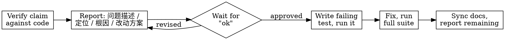

# Fix One by One from CR Docs

## Overview

A review finding is a **hypothesis**, not an instruction. Confirm it against the code, present a plan, get approval, then fix it under TDD. Never batch.

**Core principle:** One issue → one verified claim → one approved plan → one red test → one minimal fix → one full verification.

## The Shape of a Fix Session

Every issue goes through this loop, in order, and stops for approval between plan and code:



One issue per turn. "顺带" fixes belong in the next issue, not this diff.

## Step 1 — Verify Before Believing

- Read every file:line the review cites, plus callers/consumers and current migrations/config.
- Reviews go stale: a role may have been renamed, a table dropped, a duplicate item invented. **If the claim is wrong, say so and change no code.**
- If the finding may be systemic, audit every parallel path before choosing a fix. Ask: "是只有这一处漏了，还是整个架构都没有？" Report the audit result, then offer options.
- Reproduce the defect when possible (test, log, screenshot) so 问题描述 states observed behavior, not review wording.

## Step 2 — Report the Plan

Fixed output shape (Chinese, as the user expects):

```markdown
### 问题 N：<标题>
**问题描述**：真实行为 + 证据（file:line）
**根因**：为什么会这样
**改动方案**：具体文件、最小改动形态、将先写的失败测试
**验证**：要跑的命令 / 断言
```

Then **stop**. Do not edit until the user says "ok". Offer A/B only when there is a genuine architectural fork; otherwise recommend one path.

## Step 3 — TDD the Fix

- **Backend (Go):** add a test that fails for the right reason, run it red, implement, run green. Follow repo style (plain `t.Fatalf`, table tests where natural). MySQL integration tests use `CRWU_TEST_MYSQL_DSN` against `crwu-mysql` and clean up their rows (`t.Cleanup`); verify zero residue.
- **Frontend (Vitest + Testing Library):** assert user-visible behavior; watch the test fail first. If a test hangs, suspect an unstable mock dependency (a fresh object from a mocked hook re-triggers effects) — fix the mock, not the timeout.
- **Root fix over symptom patch.** If one page reveals a shared-helper bug, fix the helper and update its unit tests; do not add page-local overrides. Reuse existing patterns (e.g. `AbortController` + `isAbortError`) instead of inventing a parallel one.

## Step 4 — Verify Fully, Then Claim

Run the project's real suite, not just the targeted test:

```bash
# backend
go build ./... && go vet ./... && go test ./internal/...
gofmt -l <changed files>

# web
cd web && npm run lint && npm run typecheck && npm test -- --run && npm run build
```

For UI/layout claims, verify visually (headless screenshot before/after), not only by reading CSS. If the user wants to inspect locally, rebuild binaries and restart the dev services; never leave a stale build running.

Report results with evidence: test counts, command outcomes. "改好了" without output is not a report.

## Step 5 — Sync the Artifacts

- Tick the review doc checkbox **only after** full verification; correct the doc's own misstatements and completion counts.
- Update handoff docs, migration READMEs, and design notes in the same change when a contract, schema, or behavior changed.
- End with: what changed, verification evidence, and **remaining issue count**.

## Commit Discipline

- English Angular format: `<type>(<scope>): <subject>`; no `Co-Authored-By`.
- Commit only when asked. Never push unless asked.
- Code comments in English and sparse; explain *why*, not *what*.

## Red Flags — STOP

| Thought | Reality |
|---|---|
| "这几条都简单，一起改了吧" | Batching hides which fix broke what, and skips per-issue approval. |
| "Review 写得很具体，应该没错" | Verify anyway — reviews contain stale paths and wrong counts. |
| "先改完，测试随后补" | Delete it. Write the failing test first. |
| "我只跑刚写的测试就够了" | Run the full suite; unrelated red is still your report's job. |
| "顺手把这个也优化一下" | Out of scope. Note it, stay on the issue. |
| "改完就勾选 review 文档" | Tick only after full verification. |
| "用户没说别的，我继续下一题" | Only after reporting the current result and remaining count. |

**All of these mean: stop, return to the loop.**
