# Fix One by One from CR Docs

## Overview

A review finding is a **hypothesis**, not an instruction. Write the findings down first, confirm each against the code, present a plan that states the blast radius, get approval, then fix it under TDD and prove nothing else broke.

**Core principle:** One issue → one persisted finding → one verified claim → one approved plan (problem + consequence + root cause + change + expected effect + impacted features + derived-risk list) → one red test → one minimal fix → one blast-radius check → one full verification.

A fix that passes its own test but silently breaks a sibling path is **not done**.

## The Shape of a Fix Session

Every issue goes through this loop, in order, and stops for approval between plan and code:

```dot
digraph fix_loop {
    rankdir=LR;
    persist [label="Persist findings\nfile", shape=box];
    verify [label="Verify claim\nagainst code", shape=box];
    plan [label="Report 7 slots:\n问题/后果/根因/方案/\n效果/影响面/衍生风险", shape=box];
    wait [label="Wait for\n\"ok\"", shape=diamond];
    red [label="Write failing\ntest, run it", shape=box];
    green [label="Fix, run\ntargeted tests", shape=box];
    blast [label="Blast-radius check\n+ derived-bug hunt", shape=box];
    full [label="Full suite,\nreport evidence", shape=box];
    sync [label="Update file,\nsync docs,\nreport remaining", shape=box];

    persist -> verify -> plan -> wait;
    wait -> red [label="approved"];
    wait -> plan [label="revised"];
    red -> green -> blast -> full -> sync;
    sync -> verify [label="next finding"];
}
```



One issue per turn. "顺带" fixes belong in the next issue, not this diff.

## Step 0 — Persist the Findings File

The findings file is the session's single source of truth; conversation memory does not survive compaction, and a summary silently distorts paths and counts.

- When the review is already a repo doc with checkboxes, that doc is the findings file; keep using it.
- When it arrives any other way (chat report, audit paste, another agent's output), write it to `docs/reviews/<date>-<topic>.md` immediately. One row per finding: id, claim, `file:line`, status `todo | fixed | rejected`.
- Update the row after each fix.

**Done when** the remaining count is readable from the file alone, without this conversation.

## Step 1 — Verify Before Believing

- Read every file:line the findings file cites, plus callers/consumers and current migrations/config.
- Reviews go stale: a role may have been renamed, a table dropped, a duplicate item invented. **If the claim is wrong, say so and change no code.**
- If the finding may be systemic, audit every parallel path before choosing a fix. Ask: "是只有这一处漏了，还是整个架构都没有？" Report the audit result, then offer options.
- Reproduce the defect when possible (test, log, screenshot) so 问题描述 states observed behavior, not review wording.

## Step 2 — Report the Plan: Seven Required Slots

A plan is **not ready for approval** until all seven slots are filled. Each slot is a structural requirement — not a courtesy. Omit one and the user cannot judge whether the fix is safe, so stop and fill it.

```markdown
### 问题 N：<标题>（P1/P2/P3）

**1. 问题项**：<一句话结论> —— `file:line`
**2. 导致什么**：<谁、在什么条件下、触发什么错误行为；有复现就贴复现结果，没有就写"未复现"及依据>
**3. 根因**：<代码为什么会这样：缺失的校验、错误的合并语义、过期的默认值……>
**4. 改动方案**：<改哪些文件、最小改动形态、先写的失败测试断言>
**5. 预期效果**：<修复后可观察/可断言的行为 + 验证命令>
**6. 影响面**：<受影响的接口、页面、任务流、配置、调用方，逐项列出；每项注明怎么检查（grep/测试/手工）>
**7. 衍生风险**：<本次改动可能新引入的问题 + 对应回归检查；写"无"必须附检索证据>
```

Why each slot exists — the user approves based on these, so they must be checkable:

| 槽位 | 要回答的问题 | 不合格的写法 |
|---|---|---|
| 问题项 | 到底哪里错了 | 复述 review 原文、不给 file:line |
| 导致什么 | 造成什么后果、谁能感知 | "可能有风险"、只写代码缺陷不写用户可见行为 |
| 根因 | 为什么会出现 | 跳过根因直接给补丁 |
| 改动方案 | 怎么改、改多大 | "优化一下这段"、无最小改动边界 |
| 预期效果 | 改完怎么证明好了 | "应该没问题了" |
| 影响面 | 哪些功能会跟着变 | "相关功能"、"无"（无证据） |
| 衍生风险 | 会不会修出新的 bug | "无"（无检索证据）、不列回归检查 |

Rules for slots 6 and 7:

- 影响面 must name concrete artifacts (`GET /v1/tasks` handler, `AdminUsers` 页面、`deploy/acs` manifest), not categories. For each, say how it will be checked.
- 衍生风险 must list the specific sibling inputs that now take a different branch. If the change touches a shared helper, every caller is in scope.
- If 影响面 or 衍生风险 turns up a *second* real defect, **do not fix it here** — add it to the findings file and tell the user.
- "无" is only acceptable with the evidence that produced it (e.g. "grep `CanViewRow` 仅 2 处调用，均已覆盖").

Then **stop**. Do not edit until the user says "ok". Offer A/B only when there is a genuine architectural fork; otherwise recommend one path.

## Step 3 — TDD the Fix

- **Backend (Go):** add a test that fails for the right reason, run it red, implement, run green. Follow repo style (plain `t.Fatalf`, table tests where natural). MySQL integration tests read `CRWU_TEST_MYSQL_DSN` (bootstrap per the repo README) and clean up their rows (`t.Cleanup`); verify zero residue.
- **Frontend (Vitest + Testing Library):** assert user-visible behavior; watch the test fail first. If a test hangs, suspect an unstable mock dependency (a fresh object from a mocked hook re-triggers effects) — fix the mock, not the timeout.
- **Root fix over symptom patch.** If one page reveals a shared-helper bug, fix the helper and update its unit tests; do not add page-local overrides. Reuse existing patterns (e.g. `AbortController` + `isAbortError`) instead of inventing a parallel one.

## Step 4 — Check the Blast Radius

The green test only proves the issue you aimed at. Now walk the 影响面 list from the approved plan, item by item, and hunt for derived bugs:

| 维度 | 检查动作 |
|---|---|
| 调用方/消费方 | grep 改动符号、路由、字段的全部引用，逐个确认行为仍符合预期 |
| 接口契约 | 请求/响应字段、错误码、状态码、权限中间件顺序是否变化 |
| 双端一致 | 后端权限/状态改了，前端菜单、路由守卫、按钮、文案是否要同步 |
| 数据层 | 迁移、索引、唯一键、历史数据兼容、幂等键维度 |
| 状态机/并发 | 重试、租约、事务边界、通知去重是否被新分支破坏 |
| 配置/部署 | env、manifest、镜像 tag、overlay 是否与新默认值一致 |
| 相邻路径 | 同类代码是否存在同样缺陷（系统性问题），尤其共享 helper |

**Derived-bug rule:** for every condition or guard you changed, write down which previously-passing inputs now take the other branch, and test at least one of them. If you cannot name one, you have not looked hard enough.

Minimum evidence for "没有衍生 bug": grep hit counts, tests run for each impacted feature, and any manual/visual check. A conclusion without that evidence is not a conclusion.

## Step 5 — Verify Fully, Then Claim

Run the project's real suite, not just the targeted test. Find the repo's documented full-suite entry and use it; in this repo that is `make verify` (DB bootstrap in README「Testing」):

```bash
# backend
go build ./... && go vet ./... && gofmt -l <changed files>
make verify

# web
cd web && npm run lint && npm run typecheck && npm run test -- --run && npm run build
```

For UI/layout claims, verify visually (headless screenshot before/after), not only by reading CSS. If the user wants to inspect locally, rebuild binaries and restart the dev services; never leave a stale build running.

Report results with evidence: test counts, command outcomes, and the blast-radius checks from Step 4. "改好了" without output is not a report.

## Step 6 — Sync the Artifacts

- Mark each finding `fixed` in the findings file **only after** full verification; correct the file's own misstatements as you go.
- Update handoff docs, migration READMEs, and design notes in the same change when a contract, schema, or behavior changed.
- End with: what changed, expected effect achieved, impacted features checked, derived risks ruled out (with evidence), and **remaining count read from the findings file**.

## Commit Discipline

- English Angular format: `<type>(<scope>): <subject>`; no `Co-Authored-By`.
- Commit only when asked. Never push unless asked.
- Code comments in English and sparse; explain *why*, not *what*.

## Red Flags — STOP

| Thought | Reality |
|---|---|
| "这几条都简单，一起改了吧" | Batching hides which fix broke what, and skips per-issue approval. |
| "Review 写得很具体，应该没错" | Verify anyway — reviews contain stale paths and wrong counts. |
| "Review 在对话里，我记得住" | Compaction 后路径和计数都会失真；先写 findings 文件。 |
| "先改完，测试随后补" | Delete it. Write the failing test first. |
| "我只跑刚写的测试就够了" | Run the full suite; unrelated red is still your report's job. |
| "顺手把这个也优化一下" | Out of scope. Note it, stay on the issue. |
| "改完就勾选 review 文档" | Tick only after full verification. |
| "用户没说别的，我继续下一题" | Only after reporting the current result and remaining count. |
| "这个改动只影响这一行" | 影响面必须列调用方与消费方；grep 过再下结论。 |
| "测试绿了就没有衍生 bug" | 测试只覆盖你想到的路径；按影响面清单逐项回归。 |
| "影响面/衍生风险：无" | 没有检索证据的"无"不算结论。 |

**All of these mean: stop, return to the loop.**
